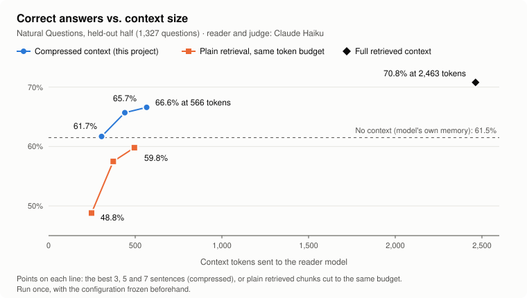
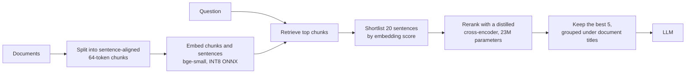

# context-middleware

**A CPU-only layer that shrinks retrieved context before it reaches the LLM.**
It sits between a RAG retriever and the model, keeps the few sentences most likely to answer the question, and passes them on word for word. It needs no GPU and makes no LLM call, and it adds about 55 ms per query.



## Results

Measured once on a held-out half of Natural Questions (1,327 questions, 20 passages each), with Claude Haiku as the reader and as the judge. The configuration was frozen before the run.

| Context sent to the model | Tokens | Correct answers |
|---|---:|---:|
| Full retrieved context | 2,463 | 70.8% |
| **Compressed, best 5 sentences (default)** | **440** | **65.7%** |
| Plain retrieval cut to the same budget | 373 | 57.5% |
| No context (the model's own memory) | 41 | 61.5% |

- **Against plain retrieval at the same token budget, compression wins by 7 to 13 points.** The 95% intervals exclude zero at every budget tested, and the same pattern holds on TriviaQA, a second set that nothing was tuned on (+4 to +13).
- **Against the full context, it loses 4 to 5 points while sending 82% fewer tokens.** It does not match full-context accuracy, and no published compressor I found does at this compression level on this kind of question.
- **Selection takes about 55 ms per query on a laptop CPU** (median, 20 passages, INT8 ONNX models).

The full account, including the experiments that failed, is in [docs/PROJECT_REPORT.md](docs/PROJECT_REPORT.md).

## How it works



| Stage | What it does | Why |
|---|---|---|
| Ingest | Splits documents into 64-token chunks on sentence boundaries and embeds every sentence ahead of time | Small chunks with no overlap retrieved the answer most often at equal token budgets. Pre-computing sentence embeddings removes the largest query-time cost |
| Shortlist | Scores sentences against the question with the bi-encoder and keeps the top 20 | Cheap filter so that the slower model reads only 20 sentences |
| Rerank | A MiniLM-L6 cross-encoder reads each sentence together with its neighbours | This model was trained on 35,900 rankings produced by Claude Haiku. It puts the answer sentence in the top 3 for 61% of questions, against 53% for the off-the-shelf model |
| Output | Keeps the best 5 sentences, in document order, under a short title per document | Readers answered better from titled groups than from bare sentences |
| Empty context | Returns nothing when the best sentence scores below a calibrated threshold | Catches 398 of 400 off-topic questions and loses 1 of 1,327 answerable ones |

An optional second reranker (a fine-tuned 68M-parameter model over the best 8 sentences) adds about 3.5 points when only 3 sentences are kept, for roughly 20 to 40 ms more. It is off by default.

Everything the model receives is copied from the source documents. Nothing is rewritten or summarised.

## Usage

```python
from context_middleware import BGE_QUERY_PREFIX, CPUMiddlewareEngine

engine = CPUMiddlewareEngine.from_pretrained(
    "models/bge-small-en-v1.5",
    query_prefix=BGE_QUERY_PREFIX,
    reranker_dir="models/distill-big-context-MiniLM-L6",
)
engine.ingest(["handbook.pdf", "faq.md"])

result = engine.optimize("How long is the warranty on refurbished units?")
print(result.compressed_prompt)        # the sentences to send to the LLM
print(result.compressed_token_count, "of", result.original_token_count, "tokens")
```

```bash
pip install -e ".[ingest]"       # runtime: numpy, onnxruntime, tokenizers, pysbd
pip install -e ".[dev]" && pytest
```

**Model weights are not in this repository.** The bi-encoder is the public `BAAI/bge-small-en-v1.5` ONNX file, converted to INT8 with `python -m context_middleware.quantization`. The distilled reranker is not published yet; `evaluation/distill.py` and `evaluation/train_distill.py` reproduce it (about $2.40 of Haiku labels and 5.5 hours on a CPU). Any ONNX cross-encoder works in its place with `rerank_context=False`.

## How it was measured

Most of the code in this repository is the measuring instrument, in `evaluation/`.

- **Two levels.** Level 1 checks whether the answer sentence survives compression, with no LLM, in seconds. Level 2 sends the context to a reader model and has a judge model grade each answer as correct, abstained or wrong.
- **A fair baseline.** The product is compared with plain retrieval cut to the same number of tokens, as well as with the full context. Comparing only with the full context flatters any compressor.
- **Paired statistics.** Every comparison is per question, with a 95% interval and a sign test. The set is large enough to detect a difference of about 3 points.
- **A held-out half.** Natural Questions was split in two. All tuning used one half, and the other was run once at the end.
- **A second dataset.** TriviaQA, with no tuning.
- **Questions with no answer in the passages**, to measure how often the reader is misled into a wrong answer.

## Limits

- It does not reach full-context accuracy. The gap is 4 to 5 points on Natural Questions and 3.5 to 5 on TriviaQA.
- When the passages are on topic but do not contain the answer, the reader gives a wrong answer about as often with compressed context as with full context (36 to 40% on Natural Questions). The empty-context rule catches off-topic questions only.
- All results are for English, Wikipedia-style passages, single-fact questions, and a context of about 2,500 tokens. Long documents and multi-step questions were not measured.
- At the price of a small model such as Haiku, saving 2,000 input tokens is worth about $0.0002 per query.

## Repository layout

| Path | Contents |
|---|---|
| `src/context_middleware/` | The library: preprocessing, retrieval, reranking, compression, output layout. Strictly typed, runtime dependencies are NumPy, ONNX Runtime, tokenizers and pysbd |
| `evaluation/` | Datasets, the two evaluation levels, the LLM judge, paired statistics, teacher labelling and reranker training |
| `tests/` | 168 unit tests; `mypy --strict` passes on the library, the tests and the evaluation code |
| `docs/` | The project report and the original design spec |

## How this was built

I am an electrical engineering student, and this was my first project in language models. I set the goals and constraints, chose which experiments to run, and decided what to keep after each result. The code was written with [Claude Code](https://claude.com/claude-code) as a pair programmer, which is why the commits carry a co-author line. The whole evaluation cost about $13 in API calls.

## License

MIT. See [LICENSE](LICENSE).
